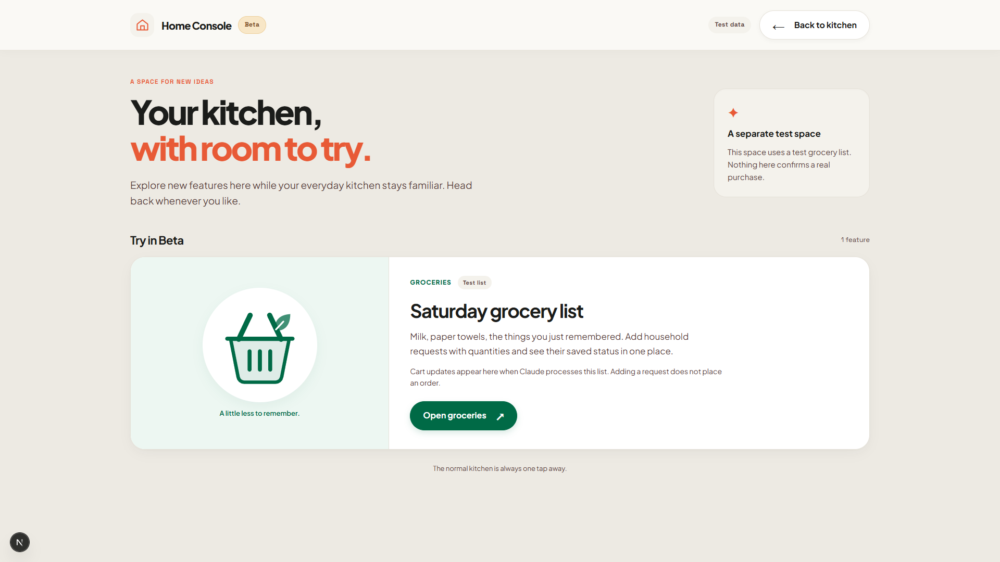

# Beta area and stable kitchen

The stable kitchen and Beta are separate running applications. The stable
launcher branch (`codex/beta-launcher`, based on main `39a227f`) adds only a
configuration-controlled navigation link. It imports no experimental components,
changes no database schema, and keeps Daniela's kitchen behavior intact.

The beta branch (`codex/beta-area`) contains the grocery work and a dedicated
`/beta` hub. `/beta/groceries` uses the existing durable grocery request UI.
Every beta page has a persistent **Back to kitchen** link, including when a child
feature errors. The grocery page also has **Back to Beta**. This first beta
feature is touch-operated; the broader kitchen voice tools are not enabled here.
The Beta and Back to kitchen links navigate the top-level tab so the normal
preview wrapper never becomes nested inside another preview.

## Local operation

- Normal private-data preview: `http://localhost:3001/` (application on 3000).
- Existing legacy grocery preview: `http://localhost:3004/`, unchanged.
- New beta application: `http://localhost:3005/beta`.
- Existing Claude development connector: unchanged, on its separate MCP server
  and tunnel. Both grocery UIs access the same isolated grocery test database;
  neither accesses the normal kitchen's private household database.

In the beta checkout, install dependencies with `npm ci`. Use the already
configured, ignored `.env.grocery-dev.local` for the dedicated database on
`127.0.0.1:55432/home_console_grocery_dev`. Do not copy production configuration.
For a new developer machine, the existing `npm run db:groceries` setup creates
an isolated local database; it is not a hosted migration command.

Run `npm run dev:beta`. Open the normal preview on localhost:3001 and click
**Beta**. On the first visit to the local Beta hub, the kitchen's local session
lets Beta set its own grocery development cookie. For direct access from a new
browser, use the local sign-in URL printed by the Beta launcher. Hosted Beta
devices still use a separate sign-in.

The Windows login task currently retains its existing normal and legacy grocery
preview configuration. A new beta startup entry has not been installed. Do not
claim beta will restart at login until that entry has been installed and checked.

## Isolation and hosted configuration

The beta launcher clears inherited app credentials, validates the dedicated local
database/container, binds only to loopback and disables external integrations.
The beta homepage redirects to the hub before loading kitchen data or weather.
Middleware allows only the beta screens, grocery API and MCP API on a beta host;
calendar, Slack, cron, Spotify, voice and normal kitchen APIs return 404 there.
Device routes fail closed without their kiosk credential; MCP authenticates with
its independent bearer key. With beta mode disabled, beta screens and the new
grocery/MCP APIs return 404.

For a future hosted beta project:

1. Use a separate deployment and Supabase project with reviewed migrations and
   its own device/MCP credentials. Set `HOME_CONSOLE_BETA_SUPABASE_URL` and
   `HOME_CONSOLE_BETA_SUPABASE_SERVICE_ROLE_KEY` for that separate project. Beta
   refuses to fall back to ordinary Supabase settings and rejects a matching
   ordinary URL or service key when those settings are also present. Still verify
   the intended project identity; different variable names alone cannot prove it.
2. Set `HOME_CONSOLE_BETA_DEPLOYMENT=1` only on that beta deployment and
   `HOME_CONSOLE_KITCHEN_URL` to the normal kitchen's public HTTPS URL.
3. Set `HOME_CONSOLE_BETA_URL` on the stable deployment to the beta HTTPS URL.
   These navigation URLs cannot include credentials, query strings or fragments.
4. Leave local development database/mode variables unset on hosted deployments.
   Authenticate the beta device independently once; the stable device token is
   not forwarded. Attach a separate Claude connector only after hosted verification.
5. Use the stable launcher change independently of the experimental branch.
   Do not merge the entire beta branch into main just to enable the button.

No Vercel deployment, hosted schema change, real cart action or Saturday-task
change is part of this local implementation. The normal main deployment workflow
and `git.deploymentEnabled=false` setting are unchanged. Existing user test items
and their receipts are preserved.

## Verification

`npm run test:beta`, `npm run test:groceries`, `npm run typecheck` and
`npm run build:grocery-check` cover URL safety, server route separation, device
authentication, regression behavior and compilation. Run the build with this
checkout's dev server stopped; it shares `.next` output.

`node scripts/beta-http-check.mjs` checks the running beta's screens and API
separation without writing requests or contacting external services. Browser
acceptance is normal kitchen -> Beta -> Open groceries -> Back to Beta ->
Back to kitchen; check the visible header at landscape sizes, reload, and a
grocery read failure. These are beta-shell checks, not evidence of real Instacart
or physical Cozyla voice operation.

November 17 local verification:

- Refreshed main is still `39a227f`; its kitchen changes are included.
- Seven beta tests, 29 grocery tests, TypeScript and the isolated build passed.
- The normal private preview's seven safety checks and TypeScript passed; its
  running browser view shows the 56px Beta link pointing to port 3005.
- The actual Beta hub components were rendered to static HTML and visually
  inspected at 1920x1080. Both navigation controls are visible. This is layout
  evidence, not a running-app navigation test.
- After Warren explicitly approved the separate startup, beta started on port
  3005. The normal preview, legacy grocery preview and Claude connector remained
  running with their existing process IDs.
- Live HTTP checks passed: authenticated screens and grocery reads work, device
  cookies cannot authenticate MCP, and normal kitchen integrations return 404.
- Live Edge checks passed at 1920x1080 and 1280x720: the one-time local sign-in,
  normal kitchen -> Beta -> groceries, reload, Back to Beta, and Back to kitchen.
  A preview-frame nesting bug found during this check was fixed with top-level
  navigation. The final round trip returns to exactly one preview wrapper.
- A browser-injected grocery read failure showed the error while keeping Back
  to kitchen usable. Existing test requests loaded; these checks made no grocery
  API writes and used no real carts or external integrations.

