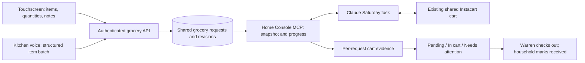
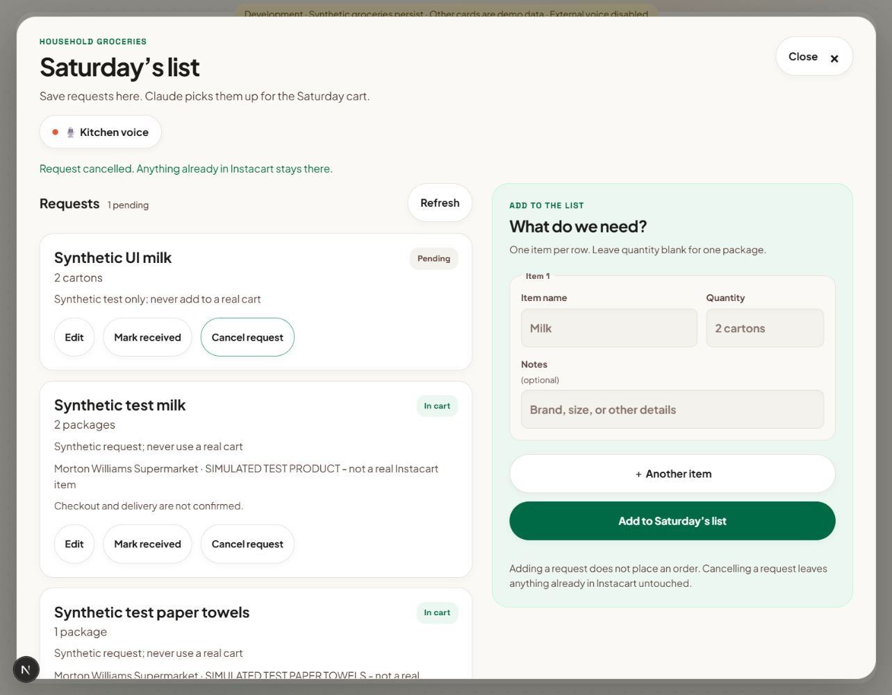

# Grocery requests: implementation plan and handoff

Updated November 16, 2026. Integration branch: `codex/grocery-flow`, based on
`39a227f35a134cde22d10a4d35104df4ba561888` after rebasing onto Daniela's November 16
navigation and weather update. Production has not been changed.

## Outcome

Save household requests on the kitchen display, let Claude's existing Saturday
worker read them through Home Console MCP, then show the recorded cart results.
The Saturday flow prepares a cart; Warren checks out. A request, a cart addition,
a purchase and delivery remain separate facts.



The local checks simulate the Cart node. They do not call Instacart or an external
voice model. The physical Cozyla microphone is still a separate acceptance test.

## Work breakdown

| Step | Deliverable and acceptance | Status |
| --- | --- | --- |
| 1. Integrate current code | New task worktree from refreshed main; retain Daniela's dinner, calendar and Gemini changes; preserve old worktrees | Done |
| 2. Preserve migration history | Unique canonical grocery versions; documented mapping from the old synthetic ledger; fresh and legacy paths checked | Done locally |
| 3. Persist device requests | Atomic batches, explicit quantities, bounded notes, operation IDs, revision-checked edits/cancel/received | Done |
| 4. Display results | Visible pending/in-cart/attention states, actual recorded product and retailer, no invented price or purchase state | Done |
| 5. Connect voice | Mount Kitchen voice within grocery panel, multi-item save, quantity preservation, success only after persistence, cleanup on stop | Implemented; actual microphone/provider check pending |
| 6. Handle failures | Fail-closed device authentication, same-origin writes, streamed request limits, save errors, same-tab recovery of uncertain submissions | Done; focused checks passed |
| 7. Test the complete flow | Actual Next voice API -> synthetic persistence -> MCP prepare/complete/replay -> display API; browser save/reload/edit/cancel | Passed locally |
| 8. Share for review | Feature branch plus draft PR, reviewer commands and screenshot | Committed locally; publication blocked by GitHub write access |
| 9. Production activation | Review migrations and live schema, private-refresh compatibility, permanent MCP host/key, attach connector to Claude v2 | Pending; no production work performed |
| 10. Device acceptance | Verify HTTPS microphone permission, far-field speech, spoken quantities and failure handling on Cozyla | Pending |
| 11. Delivery today | Persistent checkout screen, verified quote/slot provider, exact approval and order confirmation | Design only; separate phase |

## What is implemented

- `GroceryRequestsPanel` opens from the Groceries tab in the bottom navigation and pantry list.
  It has one row per item, a quantity and notes; edits/cancels use the last revision.
- `/api/groceries` and the voice grocery tools use one storage adapter. Development
  targets only the existing synthetic database on `127.0.0.1:55432`; production
  uses service-role Supabase RPCs. The browser never receives database/MCP keys.
- UI writes return persisted state. Failed saves retain the form and explain the
  uncertainty. Retrying the same operation returns the original request IDs.
  An unconfirmed addition retains its payload and operation ID in per-tab session
  storage across reloads/panel closure. Closing the entire tab ends that recovery.
- Separate new submissions are separate requests, even with the same name. The
  old name-only de-duplication cannot silently discard a stated quantity here.
- The MCP contract is unchanged: `list_pending` and `record_request_progress`.
  Cart observations are projected onto the display without worker/claim tokens.
- Received is a household action. Cancelling a request leaves anything already
  in Instacart intact. Editing an in-cart request asks Claude to review the new need.
- New grocery and voice routes require the kiosk cookie or device bearer token and fail closed
  when unconfigured. MCP uses its own bearer key. Browser mutations require same
  origin; a kiosk credential cannot authenticate to MCP.

## Local preview and checks

```sh
npm ci
npm run db:groceries
npm run dev:grocery-ui
```

Open the local-only sign-in URL printed by the launcher, on port 3004. This is a
separate preview from Warren's existing private-data preview on port 3001.
The banner identifies synthetic persisted groceries and demo dashboard cards.
The synthetic preview uses its own cookie name so it can coexist with the private
preview on the same localhost hostname.
The launcher blanks integration settings, including calendar URLs/tokens, Supabase,
Slack, OpenAI, Gemini and Spotify credentials. Calendar CLI write-back is also
disabled in this development mode. Both server weather and the new browser weather
fallback are disabled here; normal deployments retain main's NYC weather defaults
and icons. Browser audio/assets can still use the network.

```sh
npm run test:groceries
npm run typecheck
npm run test:grocery-flow-db
node --import tsx scripts/grocery-ui-smoke.ts   # while port 3004 is running
npm run build:grocery-check                  # with this worktree's dev server stopped
```

Verified in this implementation:

- 28 focused tests passed after the rebase: MCP/auth/validation, dedicated DB isolation,
  environment coverage, streaming limits, migration mapping, uncertain-save recovery,
  voice inputs and weather network isolation.
- Database checks passed: atomic batch/replay, quantities, stale edits/cancellation,
  result projection, grants, connector/lease regressions and fresh canonical migrations.
  Transaction fixtures rolled back; the fresh database was disposable and removed.
- Actual HTTP flow passed against Next: simulated voice batch/replay, MCP
  snapshot/prepare/complete/replay, display readback, separate credentials,
  cross-origin rejection and disabled external actions. Only its own fixtures were removed.
- TypeScript and credential-cleared production build passed.
- Browser save of two synthetic requests, reload persistence, quantity edit and
  cancellation passed. No browser errors/warnings were reported during inspection.
  Captured viewport was 1284 x 1002; the browser's requested 1920 x 1080 override
  did not take effect. Exact device landscape validation remains pending.

The screenshot and browser interaction checks below predate the November 16
navigation rebase. The current branch retains Daniela's consolidated bottom dock;
its Groceries tab is available from every dashboard mode. A fresh visual/device
check of that combined navigation remains pending.



The development database's older Claude test receipts remain intact. The browser
test leaves clearly named synthetic UI requests for inspection. Never attach this
synthetic database to the real Saturday cart task.

## Migration lineage and the private data refresher

The earlier standalone synthetic connector applied `0004_grocery_agent.sql` and
`0005_grocery_lease_diagnostics.sql`. Warren's separate private local Supabase
applied `0004_allow_family_google_calendar.sql`. These histories cannot be combined
by silently renumbering an applied entry.

This branch keeps the calendar migration and publishes the grocery DDL under
`20261116000100` and `20261116000200`, with the new device operations in
`20261116000300`. Exact legacy grocery sources are archived under
`supabase/legacy/grocery-development`. The standalone bootstrap checks the legacy
mapping and source equivalence and skips already-applied initialization. It never
rewrites or deletes old ledger entries. This is not a Supabase history repair.

The installed private-data refresher is unchanged. It deliberately rejects new
grocery columns/triggers and foreign keys. Its delete-and-reinsert algorithm must
be redesigned or exclude the execution-backed grocery tables before the private
copy can use this schema. Do not widen the allowlist alone: that could destroy
request/receipt relationships or overwrite local test work. Treat this as a
reviewed follow-up before deploying the grocery schema to production.

## Daniela's review and rollout sequence

Publication was attempted on November 16: terminal Git has no saved push login,
and the connected GitHub app rejected object creation with HTTP 403, "Resource not
accessible by integration". No remote branch or PR was created. The local commit
and a verified Git bundle are available; a write-enabled connection or ordinary
Git sign-in is needed to publish. This is an authentication blocker, not an
application-test failure.

1. Check out `codex/grocery-flow`; run the synthetic setup/preview above. Do not
   import production credentials. Keep your existing working copy separate.
2. Review the display interaction, migration lineage, authentication and error paths.
3. Resolve the private-data refresh strategy and audit the actual hosted migration
   history. Do not run the standalone bootstrap against hosted Supabase.
4. Apply reviewed migrations through the agreed deployment process and configure a
   distinct production MCP key plus device authentication. Leave development-only
   variables unset. The existing GitHub Actions/main deployment remains intact.
5. Deploy the permanent `/api/mcp` endpoint. Warren enters its dedicated bearer
   credential in Claude, then attaches Home Console to the cloud Saturday v2 task.
6. Run a deliberate limited real-cart check and the physical Cozyla test. Neither
   has happened as part of this implementation. Checkout remains manual.

## Delivery today: next phase

See `ON-DEMAND-GROCERY-CHECKOUT.md`. The confirmed design keeps the order screen
open until completion or explicit “Close and keep cart”, accepts voice/touch
approval of the actual total and delivery window, invalidates approval when they
change, and waits for provider order confirmation. Existing Claude cart tools
have not established that price/slot/checkout capability. Build the screen with
simulated provider responses first; verify supported provider access before real
purchasing. This branch does not change the Saturday task or enable purchases.
