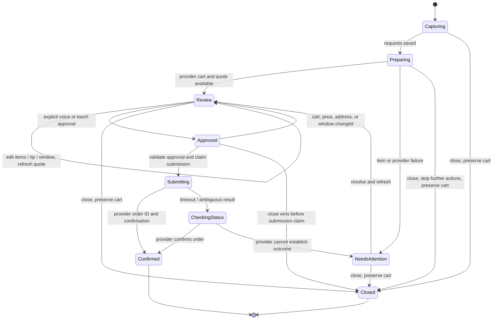

# On-demand grocery checkout on Cozyla

Decision recorded November 15, 2026 from Warren's instruction.
Design only: no checkout implementation, real cart mutation, purchase, schedule
change, or production deployment has been performed for this feature.

Working branch: `codex/grocery-checkout`, based on main
`29ac7fd48456f81ca32562a5cf2ab379ec718b65`. The tested Saturday connector remains
separate, uncommitted work on `codex/grocery-connector`; integrate through review.

## Confirmed interaction

Warren can say: "Order milk, eggs and paper towels for delivery today."

- Save each item and its stated quantity, grouped into one on-demand shopping
  session. Resolve "today" in the configured family timezone.
- Prepare the shared cart, then display the actual provider quote and available
  delivery windows on Cozyla. Follow the existing retailer preference initially;
  do not silently change stores if today's delivery is unavailable.
- Warren selects a window and approves the displayed price with either voice or
  the touchscreen. This approval authorizes the specific purchase shown.
- Keep the session visibly open through preparation, review and submission until
  the transaction completes or Warren explicitly closes it. No ambient-mode
  transition or idle timeout may silently dismiss an active session.
- Cancelling out means **close this Home Console session and keep the Instacart
  cart intact**. It must not clear the cart, undo additions, or cancel an order
  that has already been placed. Use the visible label "Close and keep cart".
- The resulting order, not merely a successful cart addition, must be confirmed
  by Instacart before the screen says "Order placed".

This updates the requested behavior for the new on-demand flow. The existing
Saturday dinner task and its two Home Console MCP tools remain cart-only with
manual checkout until separately changed. Reusing the Saturday prompt on demand
would incorrectly plan dinners and edit recipes; use a separate urgent worker.

## Persistent screen

Use the Warm Hearth design reference, landscape layout and large touch targets.
Keep requested items, existing shared-cart items, selected retailer, quote and
delivery choice visible together. Never approve only the new additions when
checkout will actually buy all items in the shared cart.

```text
+-----------------------------------------------------------------------+
| Groceries for today                       Preparing / Review / Sending |
| Heard: "Milk, eggs and paper towels for delivery today"                 |
|                                                                       |
| ITEMS IN THIS CHECKOUT                  DELIVERY                       |
| New: milk          [quantity]           [Today: provider window A]      |
| New: eggs          [quantity]           [Today: provider window B]      |
| New: paper towels  [quantity]           Deliver to: saved address label |
| Already in shared cart: [all lines]                                    |
|                                                                       |
| Selected store                          ITEMS / FEES / TAX / TIP         |
| [provider-confirmed retailer]           [provider quote breakdown]      |
|                                        Total/estimate: [provider value]|
|                                        Quote expires: [provider time]  |
|                                                                       |
| [Close and keep cart]                   [Approve <total> for <window>]  |
| Voice: "Place this order" after the current summary is read aloud      |
+-----------------------------------------------------------------------+
```

This wireframe uses placeholders, not real prices or availability. If the
provider labels a total estimated or authorizes a temporary hold, preserve that
distinction. Show any substitution/weight pricing terms that affect approval.
No raw card numbers are entered into or stored by Home Console; use the provider's
supported payment authorization flow and show only its permitted payment summary.

The screen should also offer edit and retry actions where appropriate. Closing
can leave a resumable session in Home Console history, but resuming must obtain
a fresh cart/quote/window and must never replay an old purchase approval.

## Session states and purchase boundary



Closing must race safely with submission: the server atomically accepts either
closure or the submission claim. If submission already started, closing the UI
cannot revoke a request sent to Instacart. Retain an outcome-tracking record and
report "Checking order status" until authoritative evidence arrives. Never say
"Cancelled" or automatically submit again after an ambiguous payment/order result.
An already placed order can only be cancelled through a separate explicit request
and supported provider operation; that is not this screen's Close action.

## Approval and authentication

- Reuse the device's authenticated Home Console session for voice/touch requests.
  Harden the existing missing-`KIOSK_ACCESS_TOKEN` behavior to deny access before
  enabling purchase actions. A device cookie is shared-device authentication,
  not proof of which person spoke.
- Voice and touchscreen use the same server approval operation. Require an
  explicit response to the active purchase summary; incidental speech, old
  transcripts and item text must not become approval.
- Bind approval to session ID/revision, exact complete-cart fingerprint, retailer,
  quote ID, currency, costs/fees/tax/tip, address, payment reference, selected
  window/hold ID and expiry. Record channel and timestamp. The server derives
  these values from trusted provider evidence, not an LLM-generated price.
- Invalidate approval when material details change or the quote/window expires.
  Keep the panel open, show the change and ask for fresh approval. Selecting a
  delivery window or saying "order milk" alone is not final purchase approval.
- Use a single submission key per approved purchase and the provider's supported
  idempotency/reconciliation mechanism. A duplicate tap/voice message must not
  place a second order. If the provider cannot establish the outcome, stop for
  attention; do not claim exactly-once execution across external systems.
- Keep the Claude API-trigger token, Home Console connector credential, and
  database/service credentials on their respective servers. They are distinct.
  Provider account authorization must be separately provisioned. Never copy a
  ChatGPT/Claude browser session or payment token into the kiosk backend.

## Integration evidence and open dependency

The existing Claude Instacart connector has demonstrated product search and cart
reads; the Home Console synthetic prepare/complete/replay workflow passed. Its
reported tool results do not expose prices, slots, checkout or order status.
Therefore that integration alone cannot yet implement this checkout design.

| Route | What is established | Remaining check |
| --- | --- | --- |
| Claude Code cloud task API trigger | Official docs describe an authenticated trigger and account connectors. | Verify availability on Warren's account and Home Console/Instacart tools in this task type; do not assume Cowork's existing Saturday task has an API trigger. |
| Public Instacart Developer Platform | Shopping-list/recipe links send users to Instacart to select items and check out. | This is a handoff, not evidence of a custom voice-approved checkout API. The overview mentions in-app checkout, but the required public quote/slot/order contract has not been established. |
| Instacart shopping MCP | Official docs describe OAuth, representative-provisioned access, and UI rendering for prices/ETAs. | Obtain/verify permitted access, actual tools and whether quote/window/order evidence is available to our app. |
| Instacart Connect | Documents slots, order creation and status workflows for retailer partners. | Household-app eligibility and access are unverified. |
| ChatGPT checkout | Available tool metadata requires OpenAI Payment Modal completion and its delegated payment token. | This is not a standalone Cozyla API and cannot be assumed available to Claude or our app. |

A touchscreen handoff to Instacart's own checkout on Cozyla may be a useful
intermediate option, but embedded checkout, return navigation and completion
detection are unverified. Do not promise an iframe, automatic callback, voice
control of third-party checkout or automatic completion detection without testing.

References inspected November 15, 2026:

- [Claude API-triggered tasks](https://code.claude.com/docs/en/routines#add-an-api-trigger)
- [Instacart shopping-list flow](https://docs.instacart.com/developer_platform_api/guide/concepts/shopping_list)
- [Developer Platform introduction](https://docs.instacart.com/developer_platform_api)
- [Shopping MCP requirements](https://docs.instacart.com/mcp_servers/get-started/use-instacarts-mcp-server)
- [Instacart Connect audience](https://docs.instacart.com/connect)
- [Delivery workflow](https://docs.instacart.com/connect/fulfillment_guide/concepts/fulfillment/user_journey_delivery)

## Work breakdown and acceptance

1. **Recorded:** Warren's voice/touch approval, persistent-screen and cart-preserving
   Close requirements, plus the difference from the existing Saturday task.
2. **Next, isolated prototype:** implement session transitions and screen against
   a simulated checkout provider. Clearly label test data; there is no real purchase.
3. **Provider capability check:** establish authorized quote, window, payment,
   submission and outcome APIs/UI. Production submission stays unavailable until
   those operations are verified; missing capabilities are not fabricated.
4. **Storage and task trigger:** persist urgent sessions and jobs, separate them
   from Saturday requests, add resumable progress, reuse appropriate cart leases,
   and verify the API-triggered Claude worker with synthetic data.
5. **Voice/touch wiring:** integrate the persistent panel and voice capture on
   current main without overwriting the new Dinner Hub work. Validate typed and
   spoken quantities, timezone, partial additions and honest persistence errors.
6. **Checkout and receipt:** implement approval validation, submission idempotency,
   shared-cart changes, provider confirmation and ambiguous-result recovery.
7. **Review and rollout:** reconcile the existing connector branch, review a PR,
   use isolated data first, and separately validate on the physical Cozyla. No
   automatic merge, migration, deployment or real test purchase is authorized by
   this design document.

Acceptance must cover voice and touch approval producing the same action; duplicate
approval; quote/slot expiry; another family member changing the cart; no same-day
slots; close before and during preparation; close racing with submission; delayed
provider responses; refresh/restart resuming the screen; and closing/reopening
without deleting cart lines or reusing expired approval. Keep the full order
visible until confirmed or explicitly closed. An empty cart alone is not an order
confirmation, cancellation or delivery receipt.

Repository note: refreshed main at `29ac7fd` removed `git.deploymentEnabled=false`
while the GitHub Actions workflow is also present. This differs from the earlier
deployment agreement; verify the intended configuration before publishing code.
No deployment settings were changed for this design.
